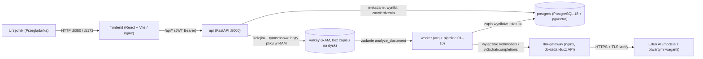

# Architektura, wyniki ewaluacji i materiały demonstracyjne — TEAMKAPA

Dokument podsumowuje architekturę rozwiązania **COI „Cyfryzacja formularzy”**, zabezpieczenia, wyniki ewaluacji, znane ograniczenia oraz gotowy scenariusz prezentacji konkursowej (Issue #4 / EPIC #1).

---

## 1. Architektura systemu

Rozwiązanie składa się z 6 usług kontenerowych odizolowanych w trzech sieciach Docker (`edge`, `internal`, `egress`) oraz jednorazowego zadania migracji bazy (`migrate`):



### Podział sieci i zasada minimalnych uprawnień
- **`edge`**: jedyne usługi dostępne z zewnątrz to `frontend` (`:8080`) i `api` (`:8000`).
- **`internal` (`internal: true`)**: brak wyjścia do internetu — `worker`, `postgres` i `valkey` nie mogą nawiązać połączenia zewnętrznego.
- **`egress`**: wyłącznie bramka `llm-gateway`, która przepuszcza tylko dwa endpointy (`GET /v3/models` i `POST /v3/chat/completions`) do `api.edenai.run` z weryfikacją TLS i dokłada nagłówek z kluczem `EDENAI_API_KEY`.
- Wszystkie kontenery działają jako użytkownicy bez uprawnień `root` (`UID 10001` dla API/workera, `UID 101` dla nginx), z systemem plików tylko do odczytu (`read_only: true`), odebranymi capabilities (`cap_drop: [ALL]`) oraz `no-new-privileges: true`.

---

## 2. Pipeline przetwarzania dokumentu i ocena pewności

1. **Walidacja wejścia (API):** sprawdzanie rozszerzenia (`PDF, DOC, DOCX, ODS, XLSX, JPG, JPEG, PNG`), nazwy pliku (≤ 250 znaków, brak znaków zabronionych `; : > < / \ | ' * % $`), rozmiaru (≤ `MAX_FILE_SIZE_MB`, domyślnie 20 MB) oraz typu MIME z treści (`libmagic` + weryfikacja struktury kontenera ZIP/OLE bez rozpakowywania).
2. **Odczyt dwukanałowy (Worker):**
   - kanał tekstowy (`step02_text_extract` — Docling, ekstraktory OOXML/ODS/DOC/PDF/obraz + OCR Tesseract),
   - kanał wizualny (`VisualAnalyzer` — OpenCV + VLM; przy braku kanału wizualnego pipeline działa w trybie zdegradowanym z jawnym obniżeniem sufitu pewności do `MEDIUM`).
3. **Etapy semantyczne 05–09:** rozpoznanie typu wniosku i dobór szablonu standardowego COI → struktura stron i sekcji → ekstrakcja pól ze źródłami → zależności dynamiczne (JSONata `SHOW`/`READ_ONLY`) i przepływ stron (`flow.links`) → deterministyczne reguły dziedzinowe (PESEL, NIP, REGON, kod pocztowy, e-mail, telefon, data) i 6 oficjalnych słowników COI (`Województwo`, `Powiat`, `Gmina`, `Miejscowość`, `Kraje`, `Numery kierunkowe`).
4. **Normalizacja i kontrola jakości:** przekształcenie do czystego pliku importu COI (`FormDefinition`, z zachowaniem klucza schematu `repetingSectionGrid`), sprawdzenie reguł technicznych (`validate_form_rules`) oraz wyznaczenie nazwanych sygnałów pewności (`source_found`, `source_element`, `ocr`, `rules`, `domain_rules`, `visual_match`) klasyfikujących każde pole do poziomu:
   - **HIGH (zielony, ≥ 0,85)** — pole pewne, nie wymaga interwencji,
   - **MEDIUM (żółty, 0,50–0,84)** — pole do przejrzenia przez urzędnika,
   - **LOW (czerwony, < 0,50)** — pole wymagające decyzji/korekty.

---

## 3. Architektura frontendu (Panel urzędnika)

Aplikacja w [frontend/](file:///c:/Users/pc/Documents/TEAMKAPAHACKNATION/TEAMKAPA/frontend/) zbudowana w **React 19 + TypeScript + Vite 6 + Tailwind CSS v4 + Zod** pokrywa pełny proces pracy urzędnika:

- **Upload pojedynczy i wsadowy (batch) oraz monitoring (`FileDropzone`, `BatchQueue`):**
  - walidacja kliencka 1:1 z backendem (`fileValidation.ts`),
  - obsługa `POST /api/v1/forms/analyze?wait=0` (natychmiastowe `202` z `job_id` umożliwiające śledzenie 7 etapów postępu oraz późniejsze zatwierdzanie),
  - obsługa `POST /api/v1/forms/batch` oraz `GET /api/v1/batches/{batch_id}` z czytelną listą plików przyjętych i odrzuconych (`rejected`),
  - historia zadań (`GET /api/v1/jobs`) z filtrowaniem statusów (`QUEUED`, `IN_PROGRESS`, `SUCCEEDED`, `FAILED`) i informacją o ponowieniach (`retry_reason`),
  - konfiguracja tokenu JWT (`sessionStorage`) oraz przełącznik **Tryb Demo (offline)**.
- **Podgląd dokumentu z nakładką `bbox` bez utrwalania plików na serwerze (`SourcePreview`, `PageOverlay`, `pdfRenderer`):**
  - zgodnie z wymogiem prywatności backend nie zapisuje przesłanych plików na dysku ani w bazie,
  - przeglądarka renderuje przesłane pliki PDF (`pdfjs-dist` na licencji Apache-2.0) oraz obrazy PNG/JPG lokalnie w pamięci i nakłada interaktywne ramki `bbox` pokolorowane według poziomu pewności,
  - kliknięcie pola po prawej stronie automatycznie przełącza stronę dokumentu i podświetla jego źródło; kliknięcie ramki `bbox` otwiera pole do edycji,
  - dla zadań historycznych dostępny jest podgląd współrzędnych oraz opcja lokalnego podpięcia pliku źródłowego (bez ponownego wysyłania na serwer).
- **Przegląd, edycja, interaktywny podgląd i zatwierdzanie (`FormRenderer`, `FieldEditorDrawer`, `QualityReportPanel`, `JsonViewer`):**
  - filtrowanie pól: *Wszystkie*, *Do przeglądu*, *Niska pewność*, *Z problemami* oraz wyszukiwarka,
  - edycja etykiety, `techName`, typu pola (z bezpieczną migracją dozwolonych kluczy), walidatorów COI, opcji własnych lub słownika COI (z wymuszeniem zasady XOR), danych inicjalnych (`PESEL` / `PESEL_ADDRESS` / `MLPZ`, 51 atrybutów), sekcji zgód oraz warunków JSONata,
  - **Podgląd wypełniania** — ewaluacja warunków `SHOW` / `READ_ONLY` (`conditionEvaluator.ts`) i walidacja formularza za pomocą Zod z polskimi walidatorami domenowymi (`PESEL`, `NIP`, `REGON`, kod pocztowy, e-mail, `ePUAP`, `ADE`, dowód),
  - **Raport jakości** — wskaźniki KPI, lista problemów `ERROR`/`WARNING`/`INFO` z przejściem do pola, elementy pominięte (`skipped_elements`), propozycje słowników z zastosowaniem 1 kliknięciem, przebieg etapów (`stages`), modele i koszt (`usage`),
  - **Zatwierdzanie i eksport** — walidacja reguł COI na żywo (`validateFormDefinitionRules`), sanityzacja kluczy pod `extra="forbid"` (`sanitizeFormForExport`), zapis przez `PUT /api/v1/jobs/{job_id}/approval` oraz pobranie czystego pliku JSON importu COI.

---

## 4. Wyniki ewaluacji i testów

### Ewaluacja deterministycznych reguł i słowników COI (`eval/run_eval.py`, leave-one-out, offline)

| Fold | Formularz | Precision | Recall | F1 | TypeAcc | Rozwiązane konflikty | Propozycje słowników | Koszt API |
| --- | --- | ---: | ---: | ---: | ---: | ---: | ---: | ---: |
| 1 | `01_wniosek_dowod` | 1.000 | 1.000 | 1.000 | 1.000 | 10 | 1/1 | \$0.0000 |
| 2 | `02_ceidg_firma` | 1.000 | 1.000 | 1.000 | 1.000 | 5 | 1/1 | \$0.0000 |
| 3 | `03_karta_duzej_rodziny` | 1.000 | 1.000 | 1.000 | 1.000 | 4 | 1/1 | \$0.0000 |
| **Średnia (Macro)** | **3 foldy** | **1.0000** | **1.0000** | **1.0000** | **1.0000** | **19 łącznie** | **3/3** | **\$0.0000** |

### Porównanie otwartych modeli językowych (`eval/compare_models.py`, domyślny tryb mock / CI)

| Model (Eden AI, otwarte wagi) | Precision | Recall | F1 | Schema | DocTop1 | Meta |
| --- | ---: | ---: | ---: | ---: | ---: | ---: |
| `scaleway/qwen3-235b-a22b-instruct-2507` | 1.0000 | 1.0000 | 1.0000 | 1.0000 | 1.0000 | 1.0000 |
| `scaleway/llama-3.3-70b-instruct` | 1.0000 | 1.0000 | 1.0000 | 1.0000 | 1.0000 | 1.0000 |
| `scaleway/gemma-3-27b-it` | 1.0000 | 1.0000 | 1.0000 | 1.0000 | 1.0000 | 1.0000 |
| `mistral/mistral-small-latest` | 1.0000 | 1.0000 | 1.0000 | 1.0000 | 1.0000 | 1.0000 |

> Uwaga metodologiczna: powyższa tabela pochodzi z trybu offline/mock wbudowanego w CI. Rzeczywiste porównanie jakości i kosztu w Eden AI uruchamia się komendą `python eval/compare_models.py --live` po ustawieniu `EDENAI_API_KEY`.

### Jakość i weryfikacja frontendu
- `npm run typecheck` (`tsc --noEmit`): **0 błędów**.
- `npm test` (`vitest run`): **4/4 pliki testowe, 17/17 testów przechodzi** (walidacja plików i batch, ewaluator JSONata, polskie walidatory domenowe i reguły COI, ścieżka E2E panelu urzędnika).
- `npm run build`: produkcyjny build Vite (`frontend/dist/`), audyt licencji npm: **0 pakietów GPL/AGPL/LGPL**.
- Test integracyjny na żywo (Docker Compose): pełny przepływ `POST /api/v1/forms/analyze?wait=0` (202) → `GET /api/v1/jobs/{id}` (`SUCCEEDED`) → `PUT /api/v1/jobs/{id}/approval` (`200 OK`, `warnings: 0`).

---

## 5. Znane ograniczenia

1. **Kanał wizualny (`OpenCV + VLM`, #10/#11):** w bieżącej wersji pipeline'u jest oznaczony jako `SKIPPED` (jeśli niepodłączony), przez co pewność pól z jednego kanału tekstowego jest celowo ograniczana do poziomu `MEDIUM`.
2. **Tryb demonstracyjny backendu (`LLM_DEMO_MODE=true`):** generuje deterministyczną odpowiedź bez wywołania modelu LLM; raport jawnie ustawia `demo_mode: true` i wszystkie pola dostają pewność `LOW` — do realnej cyfryzacji wymagane jest ustawienie `EDENAI_API_KEY` oraz `LLM_DEMO_MODE=false`.
3. **Ekstrakcja PDF w izolowanym kontenerze `worker`:** ponieważ `worker` nie ma dostępu do internetu (`internal: true`), modele Docling dla złożonych plików PDF wymagają wcześniejszego pobrania do obrazu lub wolumenu (pliki `.docx`/`.xlsx`/`.ods` działają w pełni deterministycznie bez dodatkowych wag).
4. **Brak przechowywania źródłowych obrazów po stronie serwera:** świadoma decyzja bezpieczeństwa; po odświeżeniu przeglądarki lub otwarciu starszego zadania z historii urzędnik może opcjonalnie wskazać lokalny plik przyciskiem *Plik lokalny*, aby zobaczyć nakładkę `bbox` bezpośrednio na skanie/PDF.
5. **Uwierzytelnianie JWT:** API nie posiada własnego ekranu logowania — token wystawiany jest skryptem `backend.api.token_cli` (docelowo integracja z SSO/IdP urzędu).

---

## 6. Scenariusz demonstracji konkursowej (3–5 minut)

### Przygotowanie przed prezentacją
```bash
# W katalogu TEAMKAPA:
docker compose --profile frontend up -d --build
docker compose exec -T api python -m backend.api.token_cli --sub urzednik --minutes 480
```
- Aplikacja produkcyjna: **http://localhost:8080** (lub lokalnie `npm run dev` na **http://localhost:5173**).
- Dokumentacja OpenAPI (Swagger): **http://localhost:8000/api/docs**.

### Przebieg pokazu (5 kroków)
1. **Przesyłanie i walidacja (`Przesyłanie i kolejka`):**
   - Pokaż wskaźnik **API połączone** i wklej token JWT (albo pokaż natychmiastowy **Tryb Demo** jako plan awaryjny bez internetu).
   - Przeciągnij paczkę mieszaną (np. poprawny `.docx`/`.pdf` + niedozwolony `.zip`): pokaż natychmiastową walidację kliencką, wysłanie paczki wsadowej, liczniki statusów oraz czytelne odrzucenie błędnego pliku.
2. **Przegląd wyniku i filtrowanie niepewnych pól (`Przegląd formularza`):**
   - Otwórz wynik analizy (lub kliknij **Załaduj przykład demo** dla bogatego, 2-stronicowego wniosku o numer porządkowy).
   - Wyjaśnij, że urzędnik nie musi sprawdzać całego formularza — kliknij filtr **Do przeglądu** / **Niska pewność (LOW)**, aby zawęzić listę tylko do pól wymagających uwagi.
3. **Podświetlanie źródła `bbox` i edycja pola:**
   - Kliknij pole `potwierdzenie_przelewu` lub `data_zakonczenia` — pokaż automatyczne przełączenie strony po lewej, podświetlenie ramki `bbox` oraz rozbicie sygnałów pewności po kliknięciu badge'a.
   - Zmień etykietę lub walidator w edytorze pola i pokaż, że błędna nazwa techniczna natychmiast blokuje zatwierdzenie (walidacja reguł COI na żywo).
4. **Interaktywny podgląd wypełniania i Raport jakości:**
   - Przełącz na **Podgląd wypełniania**, wybierz opcję **„Innej osoby”** — pokaż, jak warunek JSONata `SHOW` dynamicznie odsłania sekcje *Dane innej osoby* i *Opłata skarbowa*, a przycisk **Sprawdź walidację formularza** egzekwuje polskie walidatory (PESEL, kod pocztowy, e-mail).
   - Otwórz zakładkę **Raport jakości** — wskaż KPI, pominięte elementy (*Adnotacje urzędowe*, *Podpis*), użyte otwarte modele oraz zastosuj 1 kliknięciem propozycję słownika COI dla pola `miejscowosc`.
5. **Zatwierdzenie i eksport czystego JSON COI:**
   - Kliknij **Zatwierdź formularz** (`PUT /api/v1/jobs/{id}/approval`), otwórz **Podgląd JSON** i kliknij **Pobierz COI JSON** — pokaż czysty, zwalidowany plik importu gotowy do wgrania w systemie COI.
